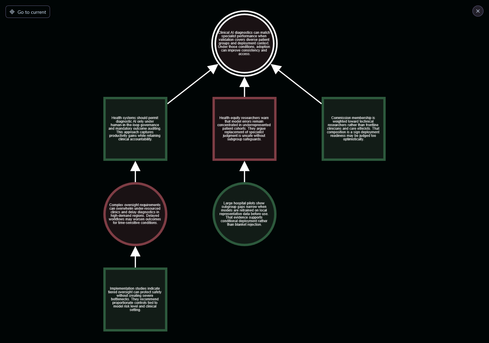
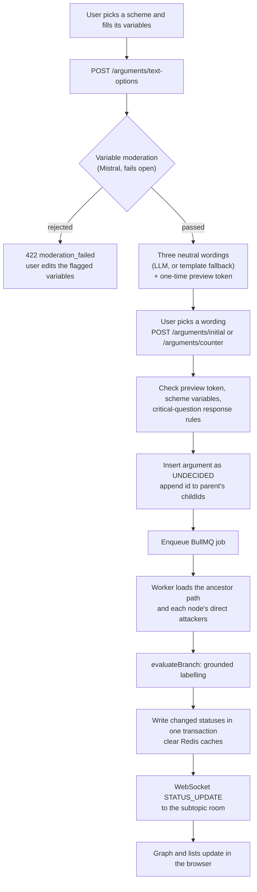
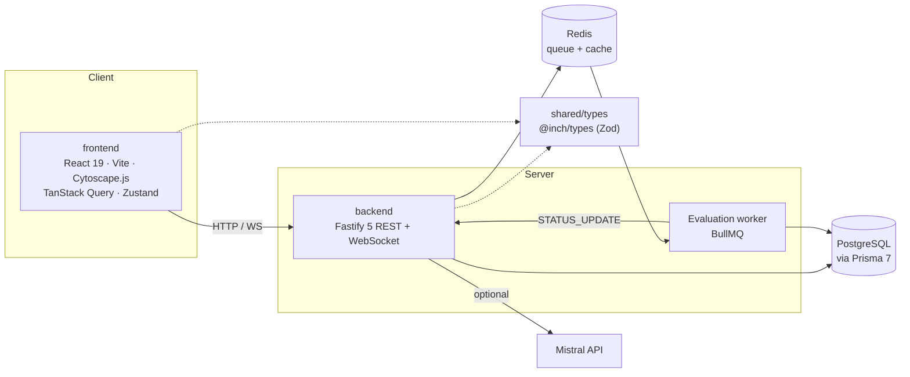

<div align="center">

<h1>INCH</h1>

<p><strong>Structured debate as an argument graph, evaluated by formal semantics rather than votes.</strong></p>

<p>
  
  
  
  
  <a href="LICENSE"></a>
</p>



</div>

---

INCH is a debate platform where every contribution is a structured argument and every reply is an attack. People don't write free text. They pick an argumentation scheme (for example *Argument from Expert Opinion*), fill in its variables, and challenge other arguments by answering one of that scheme's critical questions. Each subtopic becomes a directed attack graph, and a grounded-semantics engine labels every argument `IN`, `OUT` or `UNDECIDED` as the graph grows. An LLM helps with wording and moderation, but within fixed limits: it never decides an argument's status.

## Features

- **Scheme-based arguments.** Eight Walton-style schemes, each with typed variables and critical questions ([docs/SCHEMES.md](docs/SCHEMES.md)).
- **Counter-arguments through critical questions.** A reply must answer one of the parent's critical questions, using a scheme that question allows.
- **Live grounded evaluation.** Each new argument triggers a re-evaluation in the background, and status changes reach open pages over WebSocket.
- **Interactive graph.** A Cytoscape.js minimap and a fullscreen graph, with status-coloured nodes and the path to the current argument highlighted.
- **Bounded LLM help.** Mistral suggests schemes from free text, checks variable values before generation, and offers three neutral wordings to choose from.
- **Admin tools.** Manage schemes, critical questions, the active scheme set and admin users.
- **Shared contracts.** One Zod schema package (`@inch/types`) validates data on both the frontend and the backend.

## How it works

Every counter-argument attacks exactly one parent, so each subtopic is a forest of attack trees. An argument is `IN` when all of its attackers are `OUT` (or it has none), `OUT` when at least one attacker is `IN`, and `UNDECIDED` otherwise. On an acyclic graph exactly one labelling satisfies these rules, and that labelling is the grounded extension. Adding a leaf can only change the arguments on its path to the root, so the worker re-evaluates just that path plus each path node's direct attackers ([`evaluation.ts`](backend/src/modules/argumentation/evaluation.ts), [`evaluationWorker.ts`](backend/src/queue/evaluationWorker.ts)). The model never takes part in this step.



## Architecture



The worker runs inside the backend process and pushes updates through the backend's WebSocket rooms. Module layout, routes and design decisions are in [docs/ARCHITECTURE.md](docs/ARCHITECTURE.md); the data model is in [docs/DATA_MODEL.md](docs/DATA_MODEL.md).

## LLM boundary

> [!NOTE]
> The LLM never decides argument status and never creates attack edges. Status comes only from the grounded-semantics engine. Every model call goes through one wrapper ([`mistral.ts`](backend/src/modules/argumentation/llm/mistral.ts)) that returns `null` on any failure, and every caller has a fallback:
>
> - **Moderation fails open.** If the model is unavailable or its reply cannot be parsed, the input is allowed through, and the failure is logged. The structural checks still apply.
> - **Scheme suggestions come back empty.** The user picks a scheme by hand.
> - **Text generation uses deterministic fallbacks.** Three template phrasings of the structured argument are offered instead.
>
> INCH therefore runs end to end without a Mistral API key.

## Evaluation

| What | Result | Setup |
|---|---|---|
| Variable moderation (`withContext` prompt) | F1 **0.9412** (precision 0.9412, recall 0.9412) | 33 hand-labelled cases, `mistral-small-latest`, best of 4 prompt variants |
| Evaluation pipeline latency | p50 **100.3 ms**, p95 **276.4 ms** | 30 runs, from `evaluationQueue.add()` until the new row leaves `UNDECIDED`; excludes HTTP and WebSocket |
| Branch evaluation (in-process) | p50 0.016 ms, p95 0.50 ms for a 25-node path | 50 samples, pure function, no I/O |

Figures are as reported in the dissertation (Tables 5.1 and 5.2), measured on Node.js v25.2.1 on macOS. The latency rows round the raw values in `experiments/results/nfr/summary.json`.

- **Moderation:** findings in [FINDINGS.md](experiments/results/moderation/FINDINGS.md), numbers in [summary.json](experiments/results/moderation/summary.json), metric definitions in [moderationMetrics.ts](experiments/utils/moderationMetrics.ts), test cases in [moderationTestCases.json](experiments/data/moderationTestCases.json), runner in [runModerationExperiment.ts](experiments/scripts/runModerationExperiment.ts).
- **Latency:** results in [experiments/results/nfr/summary.json](experiments/results/nfr/summary.json) ([method](experiments/results/nfr/README.md)); code in [nfrMicrobench.ts](backend/src/benchmarks/nfrMicrobench.ts), [run-nfr-benchmark.ts](backend/scripts/run-nfr-benchmark.ts) and [nfr-pipeline-bench.ts](backend/scripts/nfr-pipeline-bench.ts).

The harness also supports a scheme-classification experiment ([docs/EXPERIMENTATION.md](docs/EXPERIMENTATION.md)); its results are not included in this repository.

## Quick start

> [!WARNING]
> Not hardened for production: error responses may expose internal details. Intended for local use and research.

<details>
<summary>Run INCH locally with your own PostgreSQL and Redis</summary>

<br>

**Prerequisites:** Node 22 LTS with npm, a PostgreSQL database you can create tables in, and Redis on `localhost:6379`. A Mistral API key is optional.

**1. Install dependencies** from the repository root. npm workspaces install every package:

```bash
npm ci
```

**2. Configure the backend:**

```bash
cp backend/.env.example backend/.env
# set DATABASE_URL and JWT_SECRET; REDIS_URL defaults to redis://localhost:6379
```

Every variable is described in [backend/.env.example](backend/.env.example). The frontend needs no `.env` when the backend is on `http://localhost:3000` ([frontend/.env.example](frontend/.env.example)).

**3. Create the schema and seed demo data:**

```bash
cd backend
npx prisma generate        # reads DATABASE_URL, even though it does not connect
npx prisma migrate deploy
npm run seed
```

On a fresh database, `migrate deploy` applies 7 migrations and the seed creates 8 schemes, 27 critical questions, 3 demo users, 2 topics, 6 subtopics and 75 arguments.

**4. Start everything** (three terminals):

```bash
redis-server                      # terminal 1
cd backend && npm run dev         # terminal 2: API + worker on http://localhost:3000
cd frontend && npm run dev        # terminal 3: http://localhost:5173
```

In the backend, `npm run dev` regenerates the Prisma client and restarts on file changes. `npm start` runs `src/server.ts` once with `tsx`, without watching; run `npx prisma generate` first if you have not used `dev`. The backend always listens on port 3000. Without Redis it still starts, but new arguments stay `UNDECIDED` because the evaluation worker is not running.

To run compiled JavaScript instead of `tsx`:

```bash
cd backend
npm run build && npm run start:prod
```

`build` runs `prisma generate`, `tsc` and then `tsc-alias`, which rewrites the `@db/*` and `@inch/types` path aliases in `dist/` to relative imports so plain `node` can load them.

</details>

## Demo accounts

<details>
<summary>Accounts created by the seed</summary>

<br>

`npm run seed` creates three demo users: `seed_user` (admin, author of the seeded debates), `janedoe` (admin) and `johndoe`. They share one demo password, set in [`backend/src/seed.ts`](backend/src/seed.ts).

**Change that password before seeding any database that other people can reach.** Anyone who reads this repository knows it, and two of the accounts are admins.

</details>

## Tests

The backend has a Jest suite (ts-jest, ESM) under `backend/test/`, mirroring `backend/src/`. Prisma, Redis, BullMQ and Fastify are mocked, so no database, Redis or API key is needed. The generated Prisma client is required, so run `npx prisma generate` first (it needs `DATABASE_URL` set, to any value).

```bash
cd backend
npm test                 # pass/fail
npm run test:coverage    # also writes a coverage report to backend/coverage/
npm run lint:check
npm run format:check     # also available in frontend/ and shared/types/
```

All 34 active suites pass: 405 tests, 0 failing. 2 placeholder suites are skipped on purpose; they cover type-only modules with no runtime code.

`npm run test:coverage` enforces one global floor: 90% lines and statements, 85% functions and branches. Measured coverage at this snapshot is 91.3% lines, 90.7% statements, 89.6% functions and 86.9% branches.

## Project structure

```
inch/
├── backend/          Fastify API, BullMQ worker, Prisma schema and migrations, Jest tests
│   ├── src/modules/  user · topic · argumentation (incl. llm/) · search · admin
│   ├── src/queue/    evaluation queue and worker
│   └── scripts/      latency benchmarks
├── frontend/         React SPA (Vite, Tailwind CSS 4, shadcn/ui, Cytoscape.js)
├── shared/types/     @inch/types: Zod schemas and the scheme catalogue
├── experiments/      offline prompt-evaluation harness and results
└── docs/             architecture, data model, requirements, schemes, setup guides
```

## Background

Built as my BSc Computer Science dissertation project at King's College London (2026). The dissertation is available on request.

Changes since submission: packaging fixes (start and seed scripts) and one bug fix (empty critical-question response lists).

## Licence

[MIT](LICENSE) © 2026 Shah Anwar
